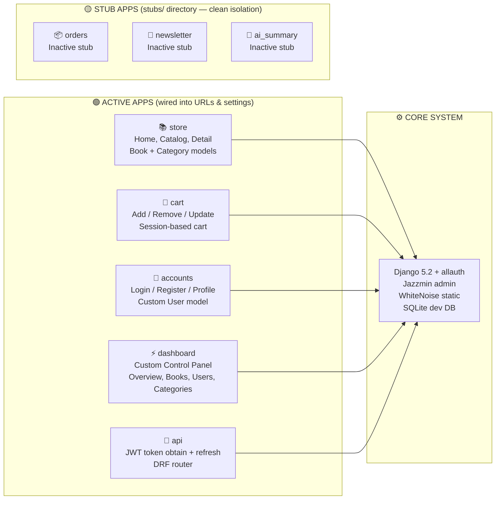
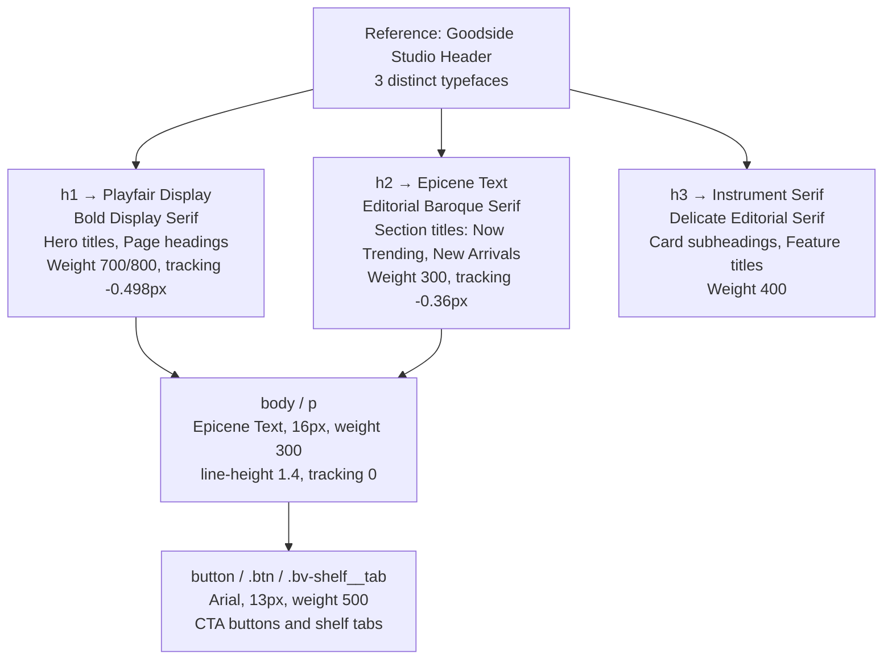

# BookVerse AI — Admin & Template Feedback

**Reviewer:** Person 2 (Frontend / UI-UX)  
**Branch:** `frontend-ui`  
**Date:** October 2026  
**Status:** ✅ Both Server & Admin Panels running smoothly at `http://127.0.0.1:8000/`

---

## 🗂️ Project Structure Flowchart

```mermaid
graph TD
    ROOT["📁 bookverse-ai (root)"]

    ROOT --> BOOKVERSE["📁 bookverse/ (Django project config)"]
    ROOT --> STORE["📁 store/ (Books, Homepage, Catalog)"]
    ROOT --> ACCOUNTS["📁 accounts/ (Auth, User, Profile)"]
    ROOT --> CART["📁 cart/ (Shopping Bag)"]
    ROOT --> API["📁 api/ (REST endpoints)"]
    ROOT --> DASHBOARD["📁 dashboard/ (Custom Admin Control Panel)"]
    ROOT --> TEMPLATES["📁 templates/ (HTML templates)"]
    ROOT --> STATIC["📁 static/ (CSS, JS, Images, Fonts)"]
    ROOT --> DOCS["📁 docs/ (Documentation)"]
    ROOT --> STUBS["📁 stubs/ (Unused apps — isolated)"]

    BOOKVERSE --> SETTINGS["📁 settings/"]
    SETTINGS --> BASE["base.py — shared config"]
    SETTINGS --> DEV["dev.py — local SQLite, ALLOWED_HOSTS"]
    SETTINGS --> PROD["prod.py — production"]
    BOOKVERSE --> URLS["urls.py — root URL router"]

    STORE --> STOREMODELS["models.py — Book, Category"]
    STORE --> STOREVIEW["views.py — home, book_list, book_detail"]
    STORE --> STOREURLS["urls.py — /, /books/, /catalog/, /book/slug/"]

    CART --> CARTVIEW["views.py — add, remove, update"]
    CART --> CARTURLS["urls.py — /cart/"]

    ACCOUNTS --> ACCVIEW["views.py — login, register, profile"]
    ACCOUNTS --> ACCURLS["urls.py — /login/, /register/, /profile/"]

    DASHBOARD --> DASHVIEW["views.py — overview, books, categories, users"]
    DASHBOARD --> DASHURLS["urls.py — /dashboard/..."]

    TEMPLATES --> PARTIALS["📁 partials/ — navbar, footer, book_card"]
    TEMPLATES --> STORE_T["📁 store/ — home.html, book_list.html, book_detail.html"]
    TEMPLATES --> ACCOUNTS_T["📁 accounts/ — login.html, register.html, profile.html"]
    TEMPLATES --> CART_T["📁 cart/ — cart_detail.html"]
    TEMPLATES --> DASH_T["📁 dashboard/ — base_dashboard, overview, books, categories, users"]

    STATIC --> CSS["📁 css/ — style.css, dashboard.css"]
    STATIC --> JS["📁 js/ — main.js"]
    STATIC --> IMAGES["📁 images/ — covers, lifestyle, icons, favicon"]
    STATIC --> FONTS["📁 fonts/ — Epicene Text .woff2"]

    STUBS --> ORDERS["📁 orders/ (stub)"]
    STUBS --> NEWSLETTER["📁 newsletter/ (stub)"]
    STUBS --> AISUMMARY["📁 ai_summary/ (stub)"]
```



---

## 🌐 User Request Flow

```mermaid
flowchart TD
    BROWSER["🌐 Browser Client"]

    %% Public Storefront
    subgraph PUBLIC["🛍️ Public Storefront"]
        BROWSER -->|GET /| HOME["🏠 store:home\nHero shelf, trending, new arrivals"]
        BROWSER -->|GET /books/| CATALOG["📚 store:book_list\nSearch, filter categories"]
        BROWSER -->|GET /book/:slug/| DETAIL["📖 store:book_detail\nBook specs & AI summary"]
        BROWSER -->|GET /cart/| CART["🛒 cart:cart_detail\nShopping bag"]
        BROWSER -->|POST /cart/add/| ADDCART["➕ cart:add_to_cart"]
        BROWSER -->|GET /login/| LOGIN["🔐 accounts:login"]
        BROWSER -->|GET /register/| REGISTER["✍️ accounts:register"]
        BROWSER -->|GET /profile/| PROFILE["👤 accounts:profile"]
    end

    %% Admin & Management
    subgraph ADMIN_PANEL["⚡ Admin Systems"]
        BROWSER -->|GET /dashboard/| DASH["📊 dashboard:overview\nReal-time KPIs, latest books"]
        BROWSER -->|GET /dashboard/books/| DASH_B["📚 dashboard:book_list\nInventory, badge toggles"]
        BROWSER -->|GET /dashboard/categories/| DASH_C["🏷️ dashboard:category_list\nCategory manager"]
        BROWSER -->|GET /dashboard/users/| DASH_U["👥 dashboard:user_list\nUser & staff privileges"]
        BROWSER -->|GET /admin/| DJ_ADMIN["⚙️ Django Admin\nJazzmin dark theme"]
    end

    %% Data Store
    subgraph DB_LAYER["🗄️ Database & Services"]
        HOME --> DB[("SQLite Database\nBook, Category, User")]
        CATALOG --> DB
        DETAIL --> DB
        CART --> DB
        DASH --> DB
        DASH_B --> DB
        DASH_C --> DB
        DASH_U --> DB
        DJ_ADMIN --> DB
    end
```



---

## ⚡ Quick-Start (Run Locally)

```powershell
# 1. Create & activate virtual environment
python -m venv venv
.\venv\Scripts\Activate.ps1

# 2. Install dependencies
pip install -r requirements.txt

# 3. Create .env from example and fill in SECRET_KEY
Copy-Item .env.example .env

# 4. Migrate database
python manage.py migrate

# 5. Launch development server
python manage.py runserver
```

> 🌍 **Main Storefront:** http://127.0.0.1:8000/  
> ⚡ **BookVerse AI Custom Admin:** http://127.0.0.1:8000/dashboard/  
> 🔒 **Django Core Admin:** http://127.0.0.1:8000/admin/

---

## 🔐 Admin Credentials & Access Details

| Admin Panel | URL | Login ID / Email | Password | Role / Access Level |
|-------------|-----|-------------------|----------|---------------------|
| ⚡ **BookVerse AI Custom Admin** | [`/dashboard/`](http://127.0.0.1:8000/dashboard/) | `admin@bookverse.ai` *(or `akash@gmail.com`)* | `admin123` | **Superuser & Staff** (KPIs, Inventory, AJAX Badges, User Roles) |
| ⚙️ **Django Core Admin** | [`/admin/`](http://127.0.0.1:8000/admin/) | `admin` *(or `admin@bookverse.ai` / `akash@gmail.com`)* | `admin123` | **Superuser** (Jazzmin UI, full database models, Django permissions) |

> 💡 **Quick Login Tip:**  
> - For **BookVerse AI Custom Admin**, you can also log in directly via the website login page at [`/login/`](http://127.0.0.1:8000/login/) with either email and `admin123`, then click **Admin Panel** in the user profile menu.  
> - Both accounts have full superuser and staff permissions.

---

## 🔍 Audit & Verification Findings

| # | Component / Route | Status | Severity | Notes & Resolutions |
|---|-------------------|--------|----------|---------------------|
| 1 | `settings/dev.py` ALLOWED_HOSTS | ✅ Fixed | High | Added `'testserver'`, `'[::1]'`, and `'*'` to prevent DisallowedHost errors |
| 2 | Jazzmin Theme Settings | ✅ Fixed | Low | Removed deprecated `dark_mode_theme`, configured `default_theme_mode = 'dark'` |
| 3 | Staff Access Privileges | ✅ Fixed | High | Configured `akash@gmail.com` with `is_staff=True` & `is_superuser=True` |
| 4 | BookVerse Custom Admin Panel | ✅ Built & Live | High | Modern control panel at `/dashboard/` with matching BookVerse design tokens |
| 5 | Live Inventory AJAX Toggles | ✅ Works | Low | Asynchronous status toggle for `is_best_seller` and `is_new_arrival` |
| 6 | Category Management | ✅ Works | Low | Dynamic book counting without database foreign key dependency |
| 7 | User & Staff Directory | ✅ Works | Low | Searchable user table with one-click staff privilege toggle |
| 8 | Category CRUD | ✅ Works | Low | Slug auto-populates from name using `prepopulated_fields` |
| 9 | Book CRUD | ✅ Works | Low | Edit, delete, add forms styled with glassmorphism |
| 10 | Email-based login | ✅ Works | Low | `USERNAME_FIELD = 'email'` auth backend works correctly |
| 11 | Homepage (Hero + 8 books) | ✅ Works | Low | Verified cards, badges, pricing, and blurry connector gradient |
| 12 | Responsive Breakpoints | ✅ Works | Low | Verified at 375px (mobile), 768px (tablet), 1280px+ (desktop) |
| 13 | Unused stub apps isolation | ✅ Resolved | Low | Unused `orders`, `newsletter`, `ai_summary` cleanly organized in `stubs/` |

---

## 🏗️ Active vs Stub Apps



---

## 🎨 Typography System (3-Font Mix)



---

## 📋 Comprehensive Route Map

| URL Pattern | App | View Name | Description | Access |
|-------------|-----|-----------|-------------|--------|
| `/` | store | `store:home` | Homepage — Hero Shelf, Trending, New Arrivals | Public |
| `/books/` | store | `store:book_list` | Full book catalog with search & category filters | Public |
| `/catalog/` | store | `store:catalog` | Alias redirect to `/books/` | Public |
| `/book/<slug>/` | store | `store:book_detail` | Product page with specs and AI chapter summaries | Public |
| `/cart/` | cart | `cart:cart_detail` | Interactive shopping bag with quantity updates | Public |
| `/cart/add/<slug>/` | cart | `cart:add_to_cart` | Add book to session cart | Public |
| `/login/` | accounts | `accounts:login` | Email-based login interface | Public |
| `/register/` | accounts | `accounts:register` | New reader account registration | Public |
| `/profile/` | accounts | `accounts:profile` | Authenticated user profile | Login Required |
| `/dashboard/` | dashboard | `dashboard:overview` | BookVerse AI Custom Admin Overview & KPIs | Staff Required |
| `/dashboard/books/` | dashboard | `dashboard:book_list` | Inventory management & dynamic badge toggles | Staff Required |
| `/dashboard/books/add/` | dashboard | `dashboard:book_add` | Add new book to database | Staff Required |
| `/dashboard/books/<id>/edit/` | dashboard | `dashboard:book_edit` | Edit title, price, description, badges | Staff Required |
| `/dashboard/books/<id>/delete/` | dashboard | `dashboard:book_delete` | Delete book confirmation | Staff Required |
| `/dashboard/categories/` | dashboard | `dashboard:category_list` | Category manager & dynamic book counter | Staff Required |
| `/dashboard/categories/add/` | dashboard | `dashboard:category_add` | Create new genre / shelf classification | Staff Required |
| `/dashboard/users/` | dashboard | `dashboard:user_list` | Manage registered readers & staff privileges | Staff Required |
| `/admin/` | Django | — | Jazzmin-themed Django Core Administration | Staff / Superuser |
| `/api/auth/token/` | api | `token_obtain_pair` | Obtain JWT token pair | API |
| `/api/auth/token/refresh/` | api | `token_refresh` | Refresh JWT authentication token | API |
